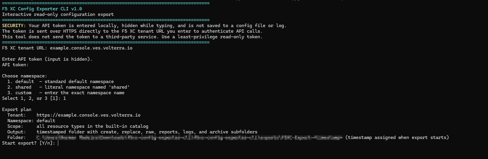
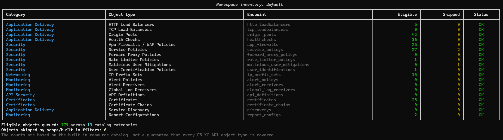

# F5 XC Config Exporter CLI v1.0

A Windows command-line utility for exporting supported F5 Distributed Cloud (F5 XC) configuration objects from **one selected namespace**. The tool uses read-only API requests and saves the original response plus F5 XC create-format and replace-format payloads where those formats are supported.

> **Important:** This is a configuration export utility, not a guaranteed full-tenant backup or one-click restore solution. Review the reports and validate exported payloads in a test environment before relying on them.

## At a glance

- Interactive prompts for tenant URL, API token, and namespace.
- API token entry is hidden while typing; the token is not saved to a configuration file.
- Preflight inventory shows the supported resource categories before export begins.
- Colorized terminal output, detailed logs, and an export progress indicator.
- Timestamped output folder and a ZIP archive for each run.
- Read-only workflow: the utility does not create, update, replace, or delete tenant objects.

## Screenshots

The screenshots below demonstrate the interface using **synthetic example values**. They do not represent a real tenant or customer configuration.

### 1. Startup and namespace selection



### 2. Preflight inventory



### 3. Export progress


### 4. Export summary


## Choose how to run the tool

There are three supported ways to launch it. Most users should use the standalone executable or `run.bat`.

### Option A — Run the standalone Windows executable

**Best if you do not want to install Python.**

**Prerequisites**

- Windows 10 or Windows 11.
- The `F5XC-Config-Exporter.exe` file from the project's v1.0 release.
- Network connectivity to your F5 XC tenant API endpoint.
- An F5 XC API token with the read permissions required for the resources you want to export.

Python is not required when using the packaged executable.

**Steps**

1. Download `F5XC-Config-Exporter.exe` from the project's GitHub Releases page.
2. Save it in a dedicated folder where you want the export files to be stored.
3. Double-click `F5XC-Config-Exporter.exe`. If Windows displays a security warning, verify that you trust the file and its source before choosing to run it.
4. Enter the F5 XC tenant URL when prompted. Use the tenant URL provided for your environment; `https://` is recommended.
5. Enter your API token. The input is hidden while you type.
6. Select `default`, `shared`, or `custom`, and enter the exact namespace name if you choose custom.
7. Review the export plan and confirm to start.
8. When the export finishes, note the output folder and ZIP archive paths shown in the terminal.

The tool writes results to an `exports` folder beneath its current working directory. For predictable output placement, keep the executable in the folder you intend to use and launch it from that folder.

### Option B — Run using `run.bat`

**Best if you downloaded the source package and have Python installed.** The launcher creates a local virtual environment and installs the required Python packages automatically.

**Prerequisites**

- Windows 10 or Windows 11.
- Python 3.11 or Python 3.12 installed and available through the Windows `py` launcher.
- Internet access during setup so pip can install the required packages.
- An F5 XC tenant URL and an API token with the required read permissions.

**Steps**

1. Download and extract the source ZIP into a folder you can write to.
2. Double-click `run.bat`.
3. Wait for the initial setup to finish. It creates `.venv` and installs the dependencies listed in `requirements.txt`.
4. Follow the prompts for tenant URL, API token, and namespace.
5. Review the export plan and confirm to start.
6. Review the final summary and the generated ZIP archive path.

If setup fails, read the error shown in the terminal. Confirm that Python 3.11 or 3.12 is installed, the `py` command works, and pip can access the package index. You can test the Python launcher from Command Prompt with `py -3 --version`.

### Option C — Run directly from Python

Use this option if you prefer to manage the Python environment and dependencies yourself.

**Prerequisites**

- Windows 10 or Windows 11.
- Python 3.11 or Python 3.12.
- Internet access to install dependencies, unless they are already available in your environment.
- An F5 XC tenant URL and an API token with the required read permissions.

Open Command Prompt in the extracted project folder and run:

```bat
py -3 --version
py -3 -m venv .venv
.venv\Scripts\python.exe -m pip install --upgrade pip
.venv\Scripts\python.exe -m pip install -r requirements.txt
.venv\Scripts\python.exe main.py
```

If the `py` launcher is unavailable, install Python from the official Python distribution and enable the launcher/PATH options during installation. Alternatively, use the full path to your Python executable in place of `py -3`.

## Selecting a namespace

At startup, choose one of the following:

1. **`default`** — export from the namespace named `default`.
2. **`shared`** — export from the namespace named `shared`.
3. **Custom** — enter the exact namespace name to export.

The export is scoped to the namespace selected in the prompt. The tool does not automatically switch to another namespace. Some collection APIs may return entries that cannot be retrieved individually; such cases are recorded in the reports for review.

## Output files

Each confirmed export creates a timestamped folder beneath `exports/` and a ZIP archive containing the run artifacts.

```text
exports/
└── F5XC-Export-YYYYMMDD-HHMMSS/
    ├── create/       # Create-format JSON payloads
    ├── replace/      # Replace-format JSON payloads
    ├── raw/          # Original GET response JSON
    ├── reports/      # Manifest and issue reports
    ├── logs/         # Detailed run log
    └── archive/      # ZIP archive of the run
```

Important reports in `reports/` include:

- `manifest.json` — summary of the run, object counts, and statuses.
- `skipped-objects.json` — objects intentionally skipped by the exporter, including configured built-in exclusions.
- `unavailable-objects.json` — collection entries whose individual detail request returned HTTP 404.
- `namespace-scope-warnings.json` — detected namespace-scope inconsistencies.
- `collection-errors.json` — collection requests that failed.
- `object-errors.json` — individual object processing failures.
- `format-errors.json` — failures retrieving or saving create/replace representations.

The exact reports present depend on the results of the run. Review the manifest and all applicable reports before treating an export as complete.

### What the JSON folders mean

- **`raw/`** — the original default GET response, retained for reference.
- **`create/`** — the API's `GET_RSP_FORMAT_FOR_CREATE` response where supported. Review and adapt the payload before creating a new object; names, namespaces, references, and other fields may need to change.
- **`replace/`** — the API's `GET_RSP_FORMAT_FOR_REPLACE` response where supported. It is intended for an applicable replace workflow and is not interchangeable with a create payload.

The exporter does not generate these formats by guessing which fields to remove from the raw response; it requests the relevant format from the API. This utility only performs GET requests. It does not apply the generated payloads to a tenant.

## Security and privacy

- Use a least-privilege API token with only the read permissions needed for your export.
- The token is entered locally with hidden input and is not written to a configuration file. The utility redacts the token from its own log messages.
- The token is sent over HTTPS to the tenant URL you enter to authenticate API requests. The utility does not send the token to a third-party service.
- Use HTTPS. Do not use an HTTP tenant URL; credentials could be exposed in transit.
- Exported configuration and logs can contain sensitive tenant details. Store them securely and inspect/redact them before sharing.
- Do not upload real exports, logs, API tokens, tenant URLs, customer names, or unredacted screenshots to public issue trackers.

## Troubleshooting

**The tool cannot connect to the tenant**

- Confirm the tenant URL is correct and includes the appropriate tenant API hostname.
- Confirm network access and proxy/firewall rules permit HTTPS connectivity.
- Check that the API token is valid and has the necessary read permissions.

**Some objects are unavailable or skipped**

- Review `reports/manifest.json`, `skipped-objects.json`, `unavailable-objects.json`, and `namespace-scope-warnings.json` where present.
- An HTTP 404 for an individual object can occur even when a collection response lists its name. This does not by itself prove that the object belongs to another namespace.
- A skipped built-in object is not counted as a successfully exported object.

**The export completed with warnings**

- Read the final summary and inspect the detailed log and reports.
- Do not assume that a successful ZIP creation means every object was exported or that every resource type is covered.

**`run.bat` reports that Python is missing**

- Install Python 3.11 or 3.12 and confirm `py -3 --version` works in Command Prompt.
- Reopen the terminal or sign out and back in if PATH settings were changed during installation.

**Windows warns about the executable**

- Only run the executable if you trust its source. Review the project's release information and any published checksum before running it, if available.

## Scope and limitations

- The exporter uses an explicit catalog of supported resource types in `f5xc_exporter/resource_registry.py`; it may not cover every F5 XC resource.
- Required permissions and API support can differ by resource type and tenant configuration.
- Create- and replace-format responses are not a guarantee of successful restoration. References, dependencies, resource versions, and API-specific requirements may need attention.
- Review all reports and validate the result in a non-production/test namespace before relying on it for migration or disaster recovery.

## Support

For a reproducible issue, open a GitHub issue and include the tool version, Python version if applicable, a description of the steps, and sanitized error messages. **Do not attach tokens, real tenant URLs, customer configuration, or unredacted export artifacts.**
